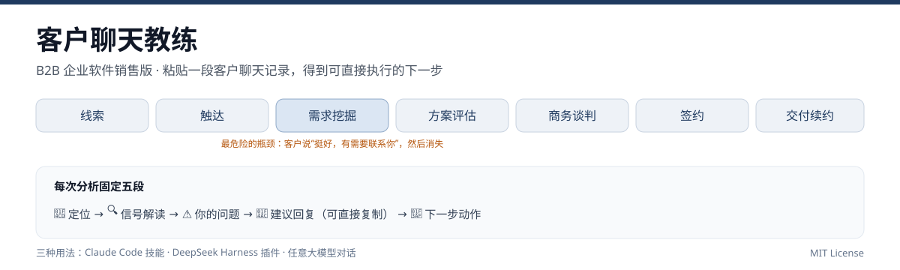

# 客户聊天教练 · Client Sales Coach（B2B 销售版）

[](LICENSE)
[](dsh-plugin)
[](https://github.com/molly0829/client-sales-coach/releases/tag/v1.0.0)



一个面向 **B2B 企业软件销售** 的 AI 教练技能包。

它把销售全流程拆成可执行的判断：**判断采购阶段、读懂客户真实态度、指出沟通失误、给出能直接发出去的回复、知道什么时候该止损**。粘贴一段客户聊天记录就能用，不需要装任何软件。

> ⚠️ 底线：这是"教练"不是"套路"。不教行贿返点、不教围标、不承诺产品做不到的事、不贬低竞品、不骚扰客户、不夸大案例。
> 诚实 > 技巧，判断 > 话术，交付口碑 > 单句金句。

---

## 功能一览

| 功能 | 说明 | 文件 |
|---|---|---|
| 💬 **客户沟通分析** | 粘贴微信/邮件/会议纪要，逐条解读信号、指出你的错误、给可直接复制的回复 | `chat-analysis.md` |
| 🎯 **购买信号识别** | 区分真兴趣 / 客套 / 压测 / 隐性拒绝，外加内部动态与决策链信号 | `signal-patterns.md` |
| 🛑 **止损决策系统** | 六维量化评估 + 分级止损 + 陪标识别，知道什么时候该放弃客户 | `damage-control.md` |
| 🔍 **销售能力诊断** | 10 项能力评分、沟通习惯自测、短板定位与改进优先级 | `self-diagnosis.md` |
| 💔 **丢单与尴尬场景** | 已有供应商 / 预算没了 / 方案被否 / 压价 / 陪标 / 对接人换人 / 被白嫖方案 | `realistic-scenarios.md` |
| 📏 **硬实力评估** | 产品力、资质、案例、价格带 → 诚实判断你能打什么段位的客户 | `hard-value-reality.md` |
| 📊 **采购阶段诊断** | 线索 → 触达 → 需求挖掘 → 方案评估 → 商务谈判 → 签约 → 续约，含退出标准 | `lifecycle.md` |
| 📚 **销售知识库** | 找线索、破冰、SPIN 提问、方案演示、报价压价、招投标、竞品应对 | `knowledge-base.md` |
| 📝 **客户档案** | 企业信息 + 决策链地图 + 时间线，跨会话追踪 | `profile-template.md` |
| 🔄 **客户看板** | 多客户管线一表看清：阶段、概率、金额、下一步、风险 | `_index.md`（模板） |

「对象」是**一家企业 + 一条决策链**（决策者 / 把关者 / 使用者 / 影响者 / 教练），不是单个联系人。

---

## 目录结构

```
客户聊天教练-skill/
├── README.md
├── LICENSE                                # MIT
├── .gitignore
├── assets/
│   └── overview.svg                       # README 顶部概览图
├── .claude/
│   ├── commands/
│   │   └── client-sales-coach.md          # /client-sales-coach 斜杠命令入口
│   └── skills/
│       └── client-sales-coach/
│           ├── SKILL.md                   # 主技能：角色、阶段、路由、底线
│           ├── TESTPLAN.md                # 22 条验收用例
│           └── references/
│               ├── chat-analysis.md       # 沟通分析五步法（核心）
│               ├── signal-patterns.md     # 信号识别库
│               ├── damage-control.md      # 止损决策
│               ├── self-diagnosis.md      # 销售自我诊断
│               ├── realistic-scenarios.md # 真实场景应对
│               ├── hard-value-reality.md  # 硬实力评估
│               ├── lifecycle.md           # 全周期路线图
│               ├── knowledge-base.md      # 销售知识库
│               └── profile-template.md    # 客户档案模板
├── samples/
│   └── demo-chat.txt                      # 示例客户聊天记录（虚构）
├── dsh-plugin/                            # DSH 插件包（把技能注册进 DSH）
│   ├── package.json
│   ├── cordis.patch.yml
│   ├── lib/index.js
│   ├── locale/en.json · zh.json
│   ├── icon.svg
│   └── skills/client-sales-coach/         # 插件内技能正文与 references
└── tools/
    ├── chat.ps1                           # 直连 DeepSeek 的命令行入口
    ├── publish-github.ps1                 # 首次发布到 GitHub（无需装 git）
    └── update-github.ps1                  # 已有仓库上推送一次更新
```

---

## 快速开始

### 方式一：Claude Code 等支持 `.claude/` 约定的环境（推荐）

1. 把本目录放到你的项目里（或把 `.claude/skills/client-sales-coach/` 复制到你的技能目录，把 `.claude/commands/client-sales-coach.md` 复制到命令目录）。
2. 在对话里输入：

```
/client-sales-coach
```

或直接粘贴客户聊天记录——技能描述里写了触发条件，助手会自动识别。

3. 第一次使用某个客户时，它会先建档；之后每次分析开头都会带一行状态标签：

```
【恒远制造 · 阶段：需求挖掘 · 赢单概率约 4 成 · ↓降温】
```

> DSH、Cursor、其他不支持 `.claude/` 目录约定的助手：直接用**方式二**或**方式三**，效果一样——技能本体就是 SKILL.md 里的提示词。

### 方式二：直接调 DeepSeek（不需要 Claude）

`tools/chat.ps1` 把技能当作系统提示，调用任意 OpenAI 兼容接口（默认 DeepSeek）：

```powershell
# 1. 设置 Key（也可以用 -ApiKey 传入）
$env:DEEPSEEK_API_KEY = "sk-你的key"

# 2. 分析一段聊天记录
.\tools\chat.ps1 -InputFile .\samples\demo-chat.txt

# 3. 带上某个客户的档案一起分析
.\tools\chat.ps1 -InputFile .\samples\demo-chat.txt -Profile .\profiles\恒远制造.md

# 4. 直接传一句话
.\tools\chat.ps1 -Text "客户：方案我看了，挺好的，有需要联系你"

# 换模型 / 换兼容服务（如通义、Kimi、本地 vLLM）
.\tools\chat.ps1 -InputFile .\a.txt -BaseUrl "https://api.moonshot.cn/v1" -Model "moonshot-v1-32k"
```

> Windows 上如果提示"禁止运行脚本"：
> `powershell -ExecutionPolicy Bypass -File .\tools\chat.ps1 -InputFile .\samples\demo-chat.txt`

### 方式三：手动使用

不装任何东西，直接把 `SKILL.md` 的内容复制到任意大模型对话框，再粘贴客户聊天记录即可。
references 目录按需追加（先给 `chat-analysis.md`，需要时再给其他）。

### 方式四：装进 DeepSeek Harness（DSH 插件）

`dsh-plugin/` 是一个标准的 DSH Host 插件包：通过 `ctx.skills.register()` 把技能注册进会话，
在 DSH 的「设置 → 插件」里可以启用、禁用、移除。

```text
plugin_manager install_bundle target = <本目录>/dsh-plugin
```

装好后新会话的技能目录里会出现 `client-sales-coach`，粘贴客户记录即自动命中。
插件内的技能正文在 `dsh-plugin/skills/client-sales-coach/`，改完重启 DSH 生效。

---

## 发布到 GitHub（可选，无需安装 git）

如果你想把这份技能包开源分享，用临时 Token 一条命令完成建仓 + 上传：

```powershell
.\tools\publish-github.ps1 -Owner 你的GitHub用户名 -Repo client-sales-coach -Token ghp_xxxxxxxx
```

Token 创建：GitHub → Settings → Developer settings → Personal access tokens →
Tokens (classic) → Generate new token，勾选 **repo** 即可。

> 上传前会自动排除 `profiles/`（客户档案）和 `.env`，不会把本地数据带上去。
> Token 用完请到设置页删除；不要把它提交到任何文件里。

---

## 它输出什么

以 `samples/demo-chat.txt` 为例（虚构数据）。下面是按技能规范**预期会得到的结构**（示例，模型实际措辞会有差异）：

```
【恒远制造 · 阶段：需求挖掘 · 赢单概率约 3 成 · ↓降温】

📍 定位
客户问过公司规模、竞品对比，说明在做初步筛选（♨️弱兴趣）；但"今年预算已用完"
+ "集团统一安排"+"内部再研究"三连，是明确的隐性拒绝（❄️）。目前只在 IT 层，
决策者未接触，六维约 4–5 分。

🔍 信号解读
1. "方案我看了，挺全面的" → 🙂客套：没提任何具体问题，等于没看。
2. "你们公司规模多大？" → 🎣压测 + ♨️弱兴趣：真在做筛选，但要给可核实事实，别吹。
3. "跟用友比怎么样" → ♨️真兴趣：在搭选型对比表，这是你能影响评分的机会。
4. "今年预算用完了" → ❄️隐性拒绝：优先级不在你身上。
5. "得看集团统一安排" → ⚠️内部动态：单点项目可能被集团收编，打法要改。

⚠️ 你的问题
1. 过早给了 86 万报价——需求没摸清、决策人没见，报价只会被拿去压对手。
2. 客户说"明年再看"，你只回了"下个月联系"，没有拿到预算周期和立项时间。
3. 全程在 IT 单点，没向上突破。

💬 建议回复（微信）
「王主任，理解，今年预算确实紧。我不催项目，就想帮您把明年的立项材料先备好：
你们合同审批和用章这两块，我按集团口径做一页纸的现状诊断和预算测算，您内部
讨论时直接能用。另外想请教一下，集团统一安排这块，是信息化条线牵头还是财务牵头？
我好按对口的人准备材料。」

意图：从"催单"切到"帮你准备立项"，同时摸清集团决策口。
预期反应：愿意透露一点立项流程，或把你引荐给集团对口人。

🎯 下一步
1. 本周内确认"集团统一安排"的具体牵头部门和立项时间（问王主任或转介绍人）。
2. 做一页纸《合同+用章现状诊断》，给王主任当汇报材料（培养教练）。
3. 六维不足 6 分，本月不再投入售前资源；按 damage-control 的 L1 观察处理。
```

---

## 怎么改成你自己的产品线

技能包故意写成"产品可替换"的结构，改三个地方就能用：

1. **`knowledge-base.md` 第八节「竞品应对」**：换成你真实的竞品和差异点。
2. **`hard-value-reality.md` 第二节「产品硬实力清单」**：填你的资质、案例、价格带。
3. **`SKILL.md` 开头 description**：改触发词（比如把"泛微"换成你的产品名）。

阶段模型、信号库、止损逻辑是通用的，不用改。

---

## 常见问题

**Q：运行 `chat.ps1` 报"在此系统上禁止运行脚本"？**
Windows 默认执行策略限制。用：
```powershell
powershell -NoProfile -ExecutionPolicy Bypass -File .\tools\chat.ps1 -InputFile .\samples\demo-chat.txt
```
或只对当前窗口放开：`Set-ExecutionPolicy -Scope Process Bypass`。

**Q：输出中文乱码？**
- 聊天记录文件请存为 **UTF-8**（记事本里选 UTF-8，不要选 ANSI/GBK）。
- `chat.ps1` 已保存为 **UTF-8 with BOM**。用编辑器改过后如果报语法错误，重新另存为 UTF-8 BOM；或直接用 PowerShell 7 运行（对编码更宽容）。

**Q：没有 DeepSeek Key 能用吗？**
能。用方式一或方式三，把 `SKILL.md` 贴给任何大模型对话框即可，不花钱、不依赖脚本。

**Q：能不能换成别的模型？**
`-BaseUrl` + `-Model` 换成任意 OpenAI 兼容接口即可（Kimi、通义、本地 vLLM 都行）。

---

## 数据与隐私

- 客户档案存 `profiles/`，已在 `.gitignore` 里排除，**不要提交到公开仓库**。
- 建议用代号（"恒远制造"）而不是真实公司全称；联系人用"王主任"而不是全名。
- 聊天记录里如果含手机号、身份证、合同编号、精确报价，粘贴前先删掉。
- `tools/chat.ps1` 只把你给的内容发给你配置的 API，不做任何额外上传。

---

## License

MIT
